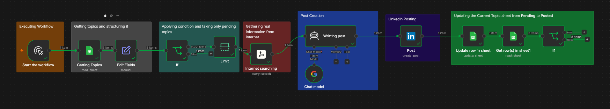
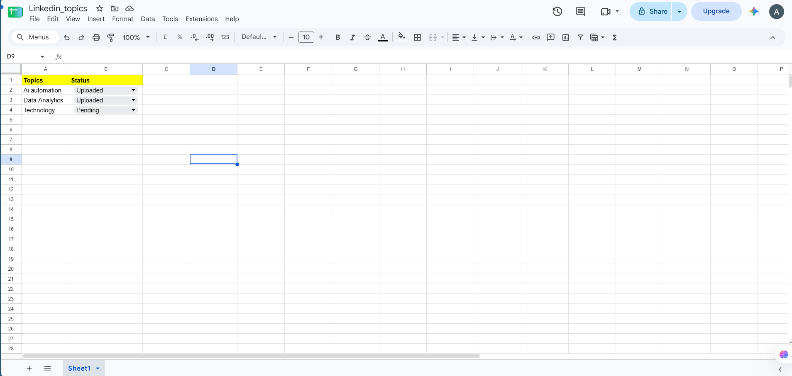

# LinkedIn Content Automation Using n8n

An automated LinkedIn content creation and publishing workflow built using **n8n, Google Sheets, Tavily AI, and Google Gemini**.

## 1. The Problem I Was Facing

Maintaining a consistent presence on LinkedIn requires regularly researching topics, creating informative posts, adding relevant hashtags, and publishing content.

However, doing all of this manually every day can be time-consuming. Finding fresh information, writing engaging posts, and remembering to publish at the right time makes consistency difficult.

I wanted to solve this problem by creating an automation that could handle the entire process with minimal manual intervention.

## 2. What I Created

I developed an automated LinkedIn content creation and publishing workflow using n8n.

The workflow takes topics from a Google Sheet, researches them using Tavily Search, generates engaging LinkedIn posts using Google Gemini, and publishes them directly to LinkedIn.

It also updates the status of each topic in Google Sheets after successful publishing, ensuring that the same topic is not repeatedly processed.

The workflow is scheduled to run three times a day:

- 9:00 AM
- 1:00 PM
- 7:00 PM

### Workflow Preview

<!-- Add your workflow screenshot below -->

*Replace the image path with your actual workflow screenshot.*

## 3. How the Automation Works

The workflow follows these steps:

1. **Schedule Trigger:** Automatically starts the workflow at predefined times (9 AM, 1 PM, and 7 PM).

2. **Google Sheets – Get Row(s):** Fetches the topics and their current publishing status from Google Sheets.

3. **Edit Fields:** Organizes the incoming data for further processing.

4. **IF Node:** Filters topics whose status is marked as `Pending`.

5. **Limit:** Selects only one pending topic per execution to avoid processing multiple topics at once.

6. **Tavily Search:** Searches the internet for relevant information based on the selected topic and returns research results.

7. **AI Agent (Google Gemini Chat Model):** Uses the research results from Tavily to generate a well-structured LinkedIn post. The prompt instructs the AI to create an engaging hook, informative paragraphs, relevant emojis, an engaging closing question, and hashtags.

8. **LinkedIn – Create a Post:** Publishes the generated content directly to my LinkedIn account.

9. **Google Sheets – Update Row:** Updates the corresponding topic's status from `Pending` to `Uploaded` after publishing.

10. **IF Node – Completion Check:** Checks whether all topics have been uploaded, supporting the topic-reset logic for the next publishing cycle.

## 4. Workflow Architecture

**Google Sheets → Filter Pending Topics → Select One Topic → Tavily Search → Google Gemini → LinkedIn Publishing → Update Google Sheets**

### Workflow Screenshot

<!-- Add another screenshot here if needed -->

## 5. Nodes and Tools Used

| Node / Tool | Purpose |
|---|---|
| Schedule Trigger | Runs automation at scheduled times |
| Google Sheets | Stores topics and tracks publishing status |
| Edit Fields | Prepares and organizes input data |
| IF | Filters pending topics and checks completion |
| Limit | Processes one topic per execution |
| Tavily Search | Retrieves relevant information from the internet |
| AI Agent | Generates LinkedIn content |
| Google Gemini Chat Model | Powers AI-based content generation |
| LinkedIn | Publishes posts automatically |
| Google Sheets Update Row | Updates publishing status |

## 6. Technologies Used

- **n8n:** Workflow automation and orchestration
- **Google Sheets:** Topic management and status tracking
- **Tavily AI:** Web search and information retrieval
- **Google Gemini:** AI-powered content generation
- **LinkedIn API Integration:** Automated post publishing
- **Docker:** Local deployment of n8n
- **ngrok:** Public access to the locally hosted n8n instance

## 7. Google Sheets Structure

The Google Sheet acts as the input and tracking system for the automation.

| Topics | Status |
|---|---|
| AI Automation | Pending |
| Data Analytics | Pending |
| Technology | Pending |
| Machine Learning | Pending |

**Status values:**
- `Pending`: Topic is waiting to be processed.
- `Uploaded`: Post has been successfully published.

New topics can be added directly to the Google Sheet without modifying the workflow.

### Google Sheets Screenshot

<!-- Add your Google Sheets screenshot here -->

## 8. AI-Generated LinkedIn Post

The AI Agent follows a structured prompt to maintain consistency in the generated content.

The generated posts include:

- An attention-grabbing opening hook.
- Four informative paragraphs.
- Relevant insights and practical examples.
- 3–5 relevant emojis.
- An engaging question to encourage interaction.
- Five relevant hashtags.
- A target length of 150–250 words.

The AI Agent uses Tavily's research output as its input instead of performing a separate web search.

## 9. Key Features

- Automated topic-based content research.
- AI-powered LinkedIn post generation.
- Automatic LinkedIn publishing.
- Scheduled publishing three times a day.
- Google Sheets integration for topic management.
- Automatic status tracking after publishing.
- Processes one pending topic per scheduled execution.
- Reduces repetitive manual work.
- Allows new topics to be added without changing the workflow.

## 10. How to Set Up

1. Install and configure n8n.
2. Import the workflow JSON into your n8n instance.
3. Connect your Google Sheets account.
4. Configure your Tavily API credentials.
5. Connect your Google Gemini API credentials.
6. Configure your LinkedIn account credentials.
7. Update the Google Sheet with your topics.
8. Configure the workflow timezone and schedule.
9. Activate the workflow.

**Note:** API credentials and account permissions are required for the integrations to work.

## 11. Future Improvements

Some improvements I would like to implement:

- AI-generated LinkedIn images for every post.
- Better content personalization based on audience and industry.
- Duplicate topic and content detection.
- Automatic publishing reports and analytics.
- Error handling and failure notifications through Telegram or email.
- Cloud deployment for continuous 24/7 execution without depending on my local machine.

## 12. Learning Outcomes

Building this project helped me understand how different applications and AI services can work together through workflow automation.

I gained practical experience with:

- Designing multi-step automation workflows.
- Integrating APIs and third-party services.
- Using AI agents for content generation.
- Connecting Google Sheets with external applications.
- Automating social media publishing.
- Managing workflow execution through scheduling and conditional logic.

---

**Project:** LinkedIn Content Automation  
**Built With:** n8n, Google Sheets, Tavily AI, Google Gemini, LinkedIn  
**Deployment:** Local Docker + ngrok  
**Linkedin_id:** www.linkedin.com/in/adarsh-pandey1527

